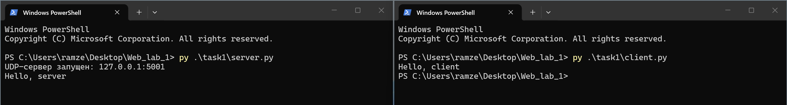
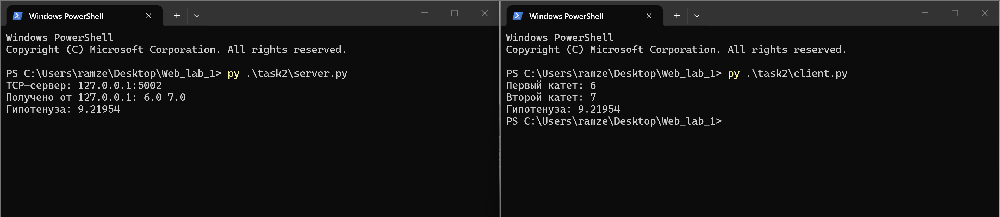
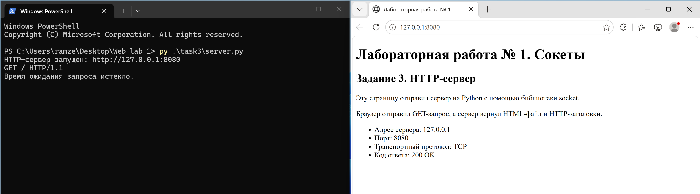
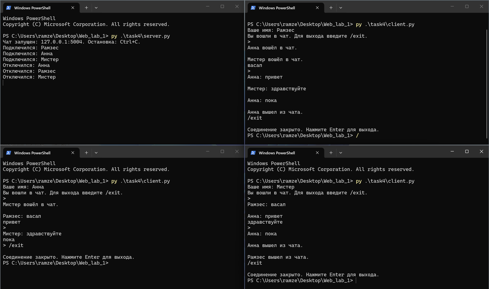
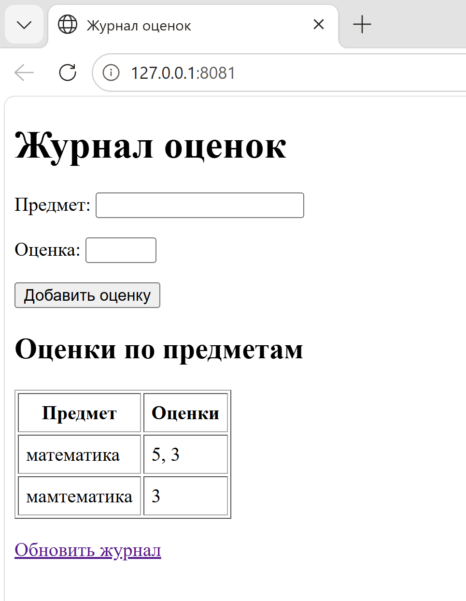

# Лабораторная работа 1. Работа с сокетами

**Студент:** Абулашвили Рамзес (Abulashvili Ramzes)  
**Группа:** K3339  
**Вариант задания 2:** 1 — теорема Пифагора

## Цель работы

Разобраться в клиент-серверном взаимодействии и передаче данных через сокеты.
Реализовать обмен по UDP и TCP, простой HTTP-сервер, многопользовательский чат
и обработку GET/POST-запросов.

## Среда и общая схема

Программы написаны на Python и используют стандартную библиотеку.
Среда выполнения — Windows и Python 3.12. Все серверы слушают
локальный адрес `127.0.0.1`; клиент и сервер запускаются в разных окнах терминала.
Для отчёта используются Markdown, MkDocs 1.6.1 и тема Material.

```text
Клиент → запрос → Сервер
Клиент ← ответ  ← Сервер
```

Сокет позволяет программе отправлять и принимать данные по сети.
Адрес IP указывает компьютер, а порт — нужное приложение на нём.
UDP передаёт отдельные датаграммы без предварительного соединения.
TCP устанавливает соединение и передаёт упорядоченный поток байтов.
Границы сообщений TCP программа определяет сама: в заданиях 2 и 4
используется перевод строки, в HTTP — конец заголовков и `Content-Length`.
Текст перед отправкой кодируется в UTF-8, а после получения декодируется обратно.

| Задание | Протокол | Порт |
| --- | --- | --- |
| 1. Обмен приветствиями | UDP | 5001 |
| 2. Теорема Пифагора | TCP | 5002 |
| 3. HTML-страница | HTTP поверх TCP | 8080 |
| 4. Чат | TCP | 5004 |
| 5. Журнал оценок | HTTP поверх TCP | 8081 |

Команды запуска выполняются из корневого каталога лабораторной работы.
Сервер останавливается сочетанием `Ctrl+C`.

## Задание 1. Обмен сообщениями по UDP

Клиент отправляет сообщение `Hello, server`. Сервер печатает его и отвечает
`Hello, client` по адресу отправителя. Для UDP используется `SOCK_DGRAM`.
Метод `recvfrom` возвращает одновременно данные и адрес, а `sendto` отправляет
датаграмму конкретному получателю. Сервер может принять несколько запросов подряд.

Запуск в двух терминалах:

```powershell
py .\task1\server.py
```

```powershell
py .\task1\client.py
```

Результат на сервере:

```text
UDP-сервер запущен: 127.0.0.1:5001
Hello, server
```

Результат на клиенте:

```text
Hello, client
```

[](images/task1.png)

### Файл task1/server.py

```python
import socket


def main():
    with socket.socket(socket.AF_INET, socket.SOCK_DGRAM) as server:
        server.bind(("127.0.0.1", 5001))
        print("UDP-сервер запущен: 127.0.0.1:5001")
        while True:
            data, address = server.recvfrom(1024)
            print(data.decode("utf-8", errors="replace"))
            server.sendto("Hello, client".encode("utf-8"), address)


if __name__ == "__main__":
    try:
        main()
    except KeyboardInterrupt:
        print("\nСервер остановлен.")
    except OSError as error:
        print(f"Ошибка сети: {error}")
```

### Файл task1/client.py

```python
import socket


def main():
    with socket.socket(socket.AF_INET, socket.SOCK_DGRAM) as client:
        client.settimeout(5)
        client.sendto("Hello, server".encode("utf-8"), ("127.0.0.1", 5001))
        data, address = client.recvfrom(1024)
        print(data.decode("utf-8"))


if __name__ == "__main__":
    try:
        main()
    except socket.timeout:
        print("Сервер не ответил. Сначала запустите server.py.")
    except OSError as error:
        print(f"Ошибка сети: {error}. Проверьте, запущен ли server.py.")
```

## Задание 2. Вычисление гипотенузы по TCP

Вариант 1: по двум катетам прямоугольного треугольника вычисляется гипотенуза.
Формула: `c = sqrt(a² + b²)`. Клиент читает числа с клавиатуры, а сервер
вычисляет результат функцией `math.hypot`.

Для TCP используется `SOCK_STREAM`. Запрос имеет вид `3.0 4.0\n`.
Перевод строки отмечает конец одного сообщения; `readline` собирает его,
даже если данные пришли несколькими частями. После ответа соединение закрывается.

Запуск в двух терминалах:

```powershell
py .\task2\server.py
```

```powershell
py .\task2\client.py
```

Пример ввода и полученного ответа:

```text
Первый катет: 6
Второй катет: 7
Гипотенуза: 9.21954
```

| Входные катеты | Полученный результат |
| --- | --- |
| 6 и 7 | Гипотенуза: 9.21954 |
| 3 и 4 | Гипотенуза: 5 |
| 5 и 12 | Гипотенуза: 13 |
| 0,3 и 0,4 в клиенте | Гипотенуза: 0.5 |

[](images/task2.png)

### Файл task2/server.py

```python
import math
import socket

HOST = "127.0.0.1"
PORT = 5002


def main():
    with socket.socket(socket.AF_INET, socket.SOCK_STREAM) as server:
        server.setsockopt(socket.SOL_SOCKET, socket.SO_REUSEADDR, 1)
        server.bind((HOST, PORT))
        server.listen()
        print(f"TCP-сервер: {HOST}:{PORT}", flush=True)
        while True:
            connection, address = server.accept()
            with connection:
                connection.settimeout(5)
                try:
                    with connection.makefile("rb") as reader:
                        data = reader.readline()
                    if not data.endswith(b"\n"):
                        continue
                    try:
                        request = data.decode("utf-8").strip()
                        print(f"Получено от {address[0]}: {request}", flush=True)
                        a, b = map(float, request.split())
                        c = math.hypot(a, b)
                        if not all(math.isfinite(value) and value > 0 for value in (a, b, c)):
                            raise ValueError
                        response = f"Гипотенуза: {c:g}"
                    except ValueError:
                        response = "Ошибка: введите два положительных конечных катета."
                    connection.sendall((response + "\n").encode("utf-8"))
                    print(response, flush=True)
                except OSError:
                    pass


if __name__ == "__main__":
    try:
        main()
    except KeyboardInterrupt:
        print("\nСервер остановлен.")
    except OSError as error:
        print(f"Ошибка сервера: {error}")
```

### Файл task2/client.py

```python
import socket

HOST = "127.0.0.1"
PORT = 5002


def main():
    try:
        a = float(input("Первый катет: ").replace(",", "."))
        b = float(input("Второй катет: ").replace(",", "."))
    except ValueError:
        print("Введите два числа.")
        return
    try:
        with socket.create_connection((HOST, PORT), timeout=5) as client:
            client.sendall(f"{a} {b}\n".encode("utf-8"))
            with client.makefile("rb") as reader:
                data = reader.readline()
            if not data:
                print("Сервер закрыл соединение без ответа.")
                return
            print(data.decode("utf-8").strip())
    except OSError as error:
        print(f"Не удалось получить ответ сервера: {error}")


if __name__ == "__main__":
    try:
        main()
    except (KeyboardInterrupt, EOFError):
        print("\nКлиент остановлен.")
```

## Задание 3. Выдача HTML-страницы

Сервер принимает TCP-соединение от браузера, считывает HTTP-заголовки
до пустой строки и отправляет содержимое файла `index.html`,
который находится рядом с программой.

Ответ состоит из строки `HTTP/1.1 200 OK`, заголовков, пустой строки и HTML.
В `Content-Type` указываются HTML и UTF-8. `Content-Length` равен числу байтов
файла, а `Connection: close` сообщает о закрытии соединения после ответа.

```powershell
py .\task3\server.py
```

Страница доступна по адресу <http://127.0.0.1:8080/>.

В окне сервера появляется:

```text
HTTP-сервер запущен: http://127.0.0.1:8080
GET / HTTP/1.1
```

[](images/task3.png)

### Файл task3/server.py

```python
import socket
from pathlib import Path


PORT = 8080


def main():
    body = Path(__file__).with_name("index.html").read_bytes()
    headers = (
        "HTTP/1.1 200 OK\r\n"
        "Content-Type: text/html; charset=utf-8\r\n"
        f"Content-Length: {len(body)}\r\n"
        "Connection: close\r\n\r\n"
    )
    with socket.socket(socket.AF_INET, socket.SOCK_STREAM) as server:
        server.setsockopt(socket.SOL_SOCKET, socket.SO_REUSEADDR, 1)
        server.bind(("127.0.0.1", PORT))
        server.listen(5)
        print(f"HTTP-сервер запущен: http://127.0.0.1:{PORT}")
        while True:
            client, address = server.accept()
            with client:
                client.settimeout(5)
                try:
                    request = b""
                    while b"\r\n\r\n" not in request:
                        part = client.recv(1024)
                        if not part:
                            break
                        request += part
                    if b"\r\n\r\n" in request:
                        print(request.split(b"\r\n", 1)[0].decode("iso-8859-1"))
                        client.sendall(headers.encode("ascii") + body)
                except socket.timeout:
                    print("Время ожидания запроса истекло.")
                except OSError as error:
                    print(f"Ошибка соединения: {error}")


if __name__ == "__main__":
    try:
        main()
    except KeyboardInterrupt:
        print("\nСервер остановлен.")
    except OSError as error:
        print(f"Ошибка сети: {error}")
```

### Файл task3/index.html

```html
<!DOCTYPE html>
<html lang="ru">
<head>
    <meta charset="utf-8">
    <meta name="viewport" content="width=device-width, initial-scale=1">
    <title>Лабораторная работа № 1</title>
</head>
<body>
    <h1>Лабораторная работа № 1. Сокеты</h1>
    <h2>Задание 3. HTTP-сервер</h2>
    <p>Эту страницу отправил сервер на Python с помощью библиотеки socket.</p>
    <p>Браузер отправил GET-запрос, а сервер вернул HTML-файл и HTTP-заголовки.</p>
    <ul>
        <li>Адрес сервера: 127.0.0.1</li>
        <li>Порт: 8080</li>
        <li>Транспортный протокол: TCP</li>
        <li>Код ответа: 200 OK</li>
    </ul>
</body>
</html>
```

## Задание 4. Многопользовательский чат

Сервер хранит подключения участников в словаре. Один и тот же клиентский скрипт
запускается в нескольких терминалах. Каждый пользователь вводит имя;
оно передаётся первой строкой и добавляется к его сообщениям.
Для различения участников при демонстрации используются разные имена.

Для каждого подключения сервер создаёт поток `threading.Thread`.
На клиенте отдельный поток принимает сообщения, пока основной поток ожидает
ввод пользователя. Входящие сообщения рассылаются всем, кроме отправителя.
Команда `/exit` завершает участие в чате. При обрыве соединения пользователь
удаляется из словаря. Блокировки защищают общий список и одновременную запись
в один сокет. Сообщения разделяются переводом строки.

Сначала запускается сервер:

```powershell
py .\task4\server.py
```

В трёх отдельных терминалах запускается одна команда:

```powershell
py .\task4\client.py
```

На скриншоте показан обмен сообщениями между участниками «Рамзес»,
«Анна» и «Мистер», а также выход с помощью команды `/exit`.

[](images/task4.png)


### Файл task4/server.py

```python
import socket
import threading

HOST = "127.0.0.1"
PORT = 5004
clients = {}
clients_lock = threading.Lock()


def disconnect(connection):
    with clients_lock:
        client = clients.pop(connection, None)
    try:
        connection.shutdown(socket.SHUT_RDWR)
    except OSError:
        pass
    connection.close()
    return client


def broadcast(message, sender=None):
    data = (message + "\n").encode("utf-8")
    with clients_lock:
        receivers = list(clients.items())
    for connection, (name, send_lock) in receivers:
        if connection is sender:
            continue
        try:
            with send_lock:
                connection.sendall(data)
        except OSError:
            disconnect(connection)


def handle_client(connection):
    name = ""
    try:
        with connection.makefile("r", encoding="utf-8", newline="\n") as reader:
            name = reader.readline().strip()
            if not name:
                return
            with clients_lock:
                clients[connection] = (name, threading.Lock())
            print(f"Подключился: {name}")
            broadcast(f"{name} вошёл в чат.", connection)
            while True:
                line = reader.readline()
                if not line:
                    break
                message = line.rstrip("\r\n")
                if message == "/exit":
                    break
                if message.strip():
                    broadcast(f"{name}: {message}", connection)
    except (OSError, UnicodeError):
        pass
    finally:
        if disconnect(connection) is not None:
            print(f"Отключился: {name}")
            broadcast(f"{name} вышел из чата.")


def main():
    with socket.socket(socket.AF_INET, socket.SOCK_STREAM) as server:
        server.bind((HOST, PORT))
        server.listen()
        print(f"Чат запущен: {HOST}:{PORT}. Остановка: Ctrl+C.")
        try:
            while True:
                connection, address = server.accept()
                threading.Thread(target=handle_client, args=(connection,), daemon=True).start()
        except KeyboardInterrupt:
            print("\nСервер остановлен.")
        finally:
            with clients_lock:
                connections = list(clients)
            for connection in connections:
                disconnect(connection)


if __name__ == "__main__":
    try:
        main()
    except OSError as error:
        print(f"Не удалось запустить сервер: {error}")
```

### Файл task4/client.py

```python
import socket
import threading

HOST = "127.0.0.1"
PORT = 5004


def receive_messages(connection, connected):
    try:
        with connection.makefile("r", encoding="utf-8", newline="\n") as reader:
            for line in reader:
                print("\n" + line.rstrip("\r\n"))
    except (OSError, UnicodeError):
        pass
    finally:
        connected.clear()
        print("\nСоединение закрыто. Нажмите Enter для выхода.")


def main():
    name = input("Ваше имя: ").strip()
    if not name:
        print("Введите имя.")
        return
    with socket.socket(socket.AF_INET, socket.SOCK_STREAM) as connection:
        connection.connect((HOST, PORT))
        connection.sendall((name + "\n").encode("utf-8"))
        connected = threading.Event()
        connected.set()
        receiver = threading.Thread(target=receive_messages, args=(connection, connected), daemon=True)
        receiver.start()
        print("Вы вошли в чат. Для выхода введите /exit.")
        try:
            while connected.is_set():
                message = input("> ")
                if not connected.is_set():
                    break
                connection.sendall((message + "\n").encode("utf-8"))
                if message == "/exit":
                    break
        except (EOFError, KeyboardInterrupt):
            print("\nВыход из чата.")
        finally:
            connected.clear()
            try:
                connection.shutdown(socket.SHUT_RDWR)
            except OSError:
                pass
            receiver.join(timeout=1)


if __name__ == "__main__":
    try:
        main()
    except (OSError, EOFError, KeyboardInterrupt) as error:
        print(f"Работа клиента завершена: {error}")
```

## Задание 5. Журнал оценок через GET и POST

Сервер вручную разбирает HTTP-запросы через `socket`.
Запрос `GET /` возвращает HTML-форму и таблицу оценок.
Форма отправляет `POST /` с полями `subject` и `grade`.
Тело запроса читается полностью по `Content-Length`, затем разбирается
функцией `parse_qs`. Предмет должен быть непустым, оценка — целым числом от 2 до 5.

Оценки хранятся в словаре: ключ — предмет, значение — список его оценок.
Поэтому повторная оценка попадает в уже существующий предмет.
При сохранении словарь записывается в `grades.json` рядом с программой.
После перезапуска сервер загружает этот файл. Новый журнал первоначально пуст.

После успешного POST сервер возвращает `303 See Other` и `Location: /`.
Браузер выполняет GET и показывает обновлённый журнал. Обычное обновление
этой страницы не отправляет оценку повторно. Названия предметов проходят
через `html.escape`, поэтому специальные символы показываются как текст.

```powershell
py .\task5\server.py
```

Журнал доступен по адресу <http://127.0.0.1:8081/>.
При последовательном добавлении оценок 5 и 3 для предмета «математика»
оценки объединяются в одной строке:

| Предмет | Оценки |
| --- | --- |
| математика | 5, 3 |

Соответствующая структура данных:

```json
{
  "математика": [5, 3]
}
```

База данных и сторонние веб-фреймворки не используются.

[](images/task5.png)

### Файл task5/server.py

```python
import json
import socket
from html import escape
from pathlib import Path
from urllib.parse import parse_qs

HOST = "127.0.0.1"
PORT = 8081
DATA_FILE = Path(__file__).with_name("grades.json")


def make_page(grades, message=""):
    rows = "".join(
        f"<tr><td>{escape(subject)}</td><td>{', '.join(map(str, marks))}</td></tr>"
        for subject, marks in grades.items()
    )
    if not rows:
        rows = '<tr><td colspan="2">Оценок пока нет.</td></tr>'
    return f"""<!DOCTYPE html>
<html lang="ru">
<head>
    <meta charset="utf-8">
    <title>Журнал оценок</title>
</head>
<body>
    <h1>Журнал оценок</h1>
    <p>{escape(message)}</p>
    <form method="post" action="/">
        <p><label>Предмет: <input name="subject" required></label></p>
        <p><label>Оценка: <input name="grade" type="number" min="2" max="5" required></label></p>
        <button type="submit">Добавить оценку</button>
    </form>
    <h2>Оценки по предметам</h2>
    <table border="1" cellpadding="6">
        <tr><th>Предмет</th><th>Оценки</th></tr>
        {rows}
    </table>
    <p><a href="/">Обновить журнал</a></p>
</body>
</html>"""


def send_response(connection, status, page, extra_headers=None):
    body = page.encode("utf-8")
    headers = [
        f"HTTP/1.1 {status}",
        "Content-Type: text/html; charset=utf-8",
        f"Content-Length: {len(body)}",
        "Connection: close",
    ]
    for name, value in (extra_headers or {}).items():
        headers.append(f"{name}: {value}")
    response = "\r\n".join(headers) + "\r\n\r\n"
    connection.sendall(response.encode("ascii") + body)


def read_request(connection):
    data = b""
    while b"\r\n\r\n" not in data:
        chunk = connection.recv(4096)
        if not chunk:
            raise ValueError("Запрос не получен полностью.")
        data += chunk
    header_data, body = data.split(b"\r\n\r\n", 1)
    lines = header_data.decode("iso-8859-1").split("\r\n")
    method, path, version = lines[0].split()
    headers = {}
    for line in lines[1:]:
        name, value = line.split(":", 1)
        headers[name.lower()] = value.strip()
    length = int(headers.get("content-length", "0"))
    if length < 0:
        raise ValueError("Неверная длина тела запроса.")
    while len(body) < length:
        chunk = connection.recv(min(4096, length - len(body)))
        if not chunk:
            raise ValueError("Тело запроса не получено полностью.")
        body += chunk
    return method, body[:length]


def handle_request(connection, grades):
    method, body = read_request(connection)
    if method == "GET":
        send_response(connection, "200 OK", make_page(grades))
        return
    if method != "POST":
        send_response(connection, "405 Method Not Allowed", make_page(grades, "Метод не поддерживается."), {"Allow": "GET, POST"})
        return
    form = parse_qs(body.decode("utf-8"))
    subject = form.get("subject", [""])[0].strip()
    mark = form.get("grade", [""])[0].strip()
    if not subject or mark not in ("2", "3", "4", "5"):
        send_response(connection, "400 Bad Request", make_page(grades, "Укажите предмет и целую оценку от 2 до 5."))
        return
    updated = {**grades, subject: grades.get(subject, []) + [int(mark)]}
    DATA_FILE.write_text(json.dumps(updated, ensure_ascii=False, indent=2), encoding="utf-8")
    grades.update(updated)
    send_response(connection, "303 See Other", make_page(grades, "Оценка сохранена."), {"Location": "/"})


def main():
    grades = {}
    if DATA_FILE.exists():
        grades = json.loads(DATA_FILE.read_text(encoding="utf-8"))
    with socket.socket(socket.AF_INET, socket.SOCK_STREAM) as server:
        server.bind((HOST, PORT))
        server.listen()
        print(f"Журнал оценок: http://{HOST}:{PORT}/. Остановка: Ctrl+C.")
        while True:
            connection, address = server.accept()
            with connection:
                connection.settimeout(5)
                try:
                    handle_request(connection, grades)
                except (ValueError, OSError) as error:
                    print(f"Не удалось обработать запрос от {address}: {error}")


if __name__ == "__main__":
    try:
        main()
    except KeyboardInterrupt:
        print("\nСервер остановлен.")
    except (OSError, ValueError) as error:
        print(f"Не удалось запустить сервер: {error}")
```

## Результаты работы

| Задание | Основной результат |
| --- | --- |
| 1 | Приветствия передаются в обе стороны по UDP |
| 2 | Сервер вычисляет гипотенузу по двум катетам |
| 3 | Браузер получает HTML-файл с корректными HTTP-заголовками |
| 4 | Три участника обмениваются сообщениями одновременно |
| 5 | Оценки группируются по предмету и сохраняются после перезапуска |

## Вывод

В работе реализованы основные способы сетевого обмена через сокеты.
UDP использован для короткого обмена сообщениями, TCP — для вычислений и чата.
HTTP-запросы разбираются, а ответы формируются вручную. Потоки позволяют чату обслуживать
нескольких участников одновременно, а GET и POST позволяют получать страницу
журнала и добавлять в него данные.

## Источники

- [Задание ЛР1](https://rendex85.github.io/ITMO_ICT_WebDevelopment_Docs/lab1/assignment/).
- [Теория](https://rendex85.github.io/ITMO_ICT_WebDevelopment_Docs/lab1/theory/).
- [Примеры реализации](https://rendex85.github.io/ITMO_ICT_WebDevelopment_Docs/lab1/practice1/).
- [Оформление отчёта](https://rendex85.github.io/ITMO_ICT_WebDevelopment_Docs/submission/mkdocs-deploy/).
- [Репозиторий курса 2026–2027](https://github.com/TonikX/ITMO_ICT_WebDevelopment_2026-2027/blob/main/README.md).
- [Учебник по работе с сокетами](https://tonikx.github.io/web_development_book/labs/1_working_with_sockets/main_text/).
