# Лабораторная работа 2. Сайт научных конференций

**Студент:** Абулашвили Рамзес (Abulashvili Ramzes)  
**Группа:** K3339  
**Вариант:** 5 — список научных конференций

## Цель работы

Разработать сайт на Django с моделями данных, HTML-шаблонами и базой PostgreSQL.
Реализовать просмотр конференций, регистрацию авторов для выступлений,
отзывы и работу организатора с результатами выступлений.

## Средства разработки

Используются Python 3.12, Django 5.2, PostgreSQL 18 и Jinja2.
Клиентская часть оформлена собственным CSS. Шаблоны сайта обрабатываются Jinja2,
а встроенная административная панель использует стандартные шаблоны Django.
Взаимодействие с базой выполняется через Django ORM.

## Модель данных

| Модель | Основные поля и связи |
| --- | --- |
| `User` | Имя пользователя, пароль, имя, фамилия, email, права доступа |
| `Topic` | Название тематики |
| `Venue` | Название площадки, город, адрес, описание места |
| `Conference` | Название, тематики, площадка, даты начала и окончания, описание, условия участия |
| `Registration` | Конференция, автор, тема выступления, организация, аннотация, результат |
| `Review` | Конференция, автор, даты конференции, текст, оценка от 1 до 10, дата отзыва |

У конференции может быть несколько тематик, одна тематика может относиться
к нескольким конференциям. С площадкой конференция связана внешним ключом.
Заявка соединяет автора и конференцию и хранит сведения о выступлении.
Для одного автора предусмотрена одна заявка на конкретную конференцию.

### Заявка на выступление

```python
class Registration(models.Model):
    class Result(models.TextChoices):
        PENDING = "pending", "Ожидает решения"
        RECOMMENDED = "recommended", "Рекомендован к публикации"
        NOT_RECOMMENDED = "not_recommended", "Не рекомендован к публикации"

    conference = models.ForeignKey(Conference, on_delete=models.CASCADE, related_name="registrations", verbose_name="Конференция")
    author = models.ForeignKey(settings.AUTH_USER_MODEL, on_delete=models.CASCADE, related_name="registrations", verbose_name="Автор")
    presentation_title = models.CharField("Тема выступления", max_length=200)
    affiliation = models.CharField("Организация", max_length=150)
    abstract = models.TextField("Аннотация", blank=True)
    result = models.CharField("Результат выступления", max_length=20, choices=Result.choices, default=Result.PENDING)
    created_at = models.DateTimeField("Дата регистрации", auto_now_add=True)

    class Meta:
        ordering = ["conference__start_date", "author__last_name", "pk"]
        constraints = [models.UniqueConstraint(fields=["conference", "author"], name="unique_conference_author")]
        verbose_name = "Заявка на выступление"
        verbose_name_plural = "Заявки на выступления"

    def __str__(self):
        return f"{self.author} — {self.conference}"
```

В отзыве даты конференции записываются отдельными полями при создании.
Поэтому отзыв хранит период, к которому он относится, даже если сведения
о конференции впоследствии изменятся.

## Регистрация и вход

Посетитель может открыть список конференций, описание конференции и участников.
Для подачи заявки и написания отзыва нужен аккаунт.
Форма регистрации запрашивает имя пользователя, имя, фамилию, email и пароль.
После создания аккаунта пользователь сразу входит на сайт.
Для последующих входов используется стандартный механизм сессий Django.

[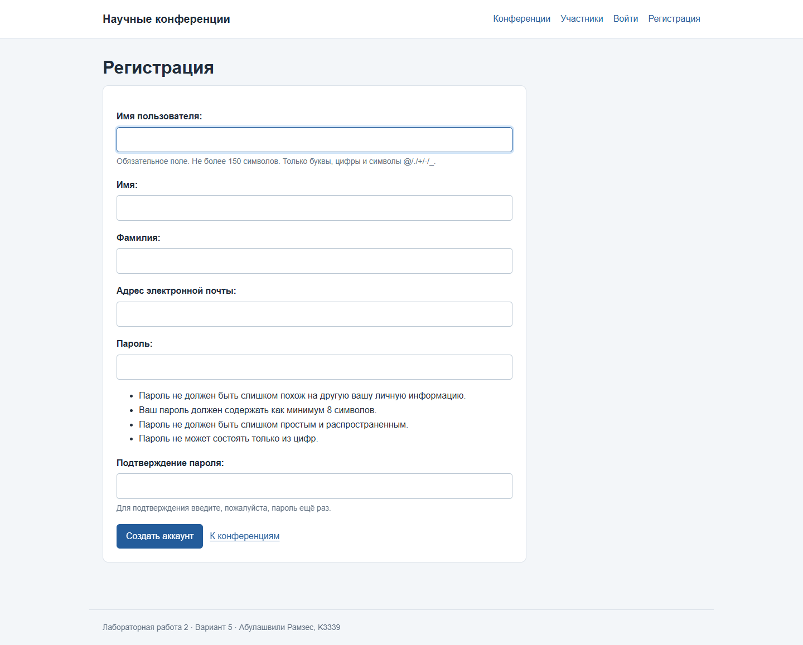](images/lab2/signup.png)

[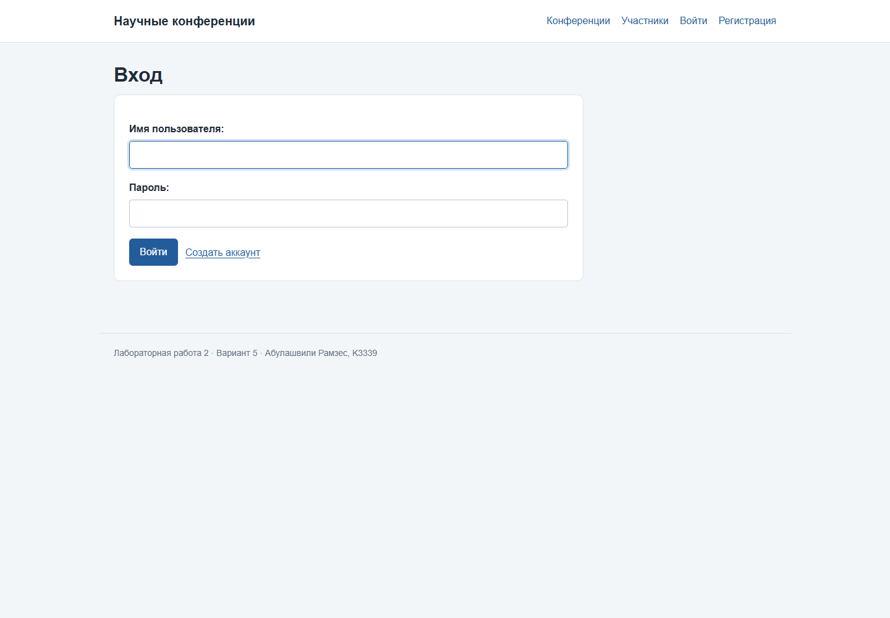](images/lab2/login.png)

## Список конференций, поиск и фильтры

На главной странице показаны карточки с названием, датами, городом,
площадкой, тематиками и кратким описанием. Поиск работает по названию
и описанию; фильтры — по тематике и городу.
На одной странице размещается четыре конференции. При переходе между
страницами выбранные условия поиска сохраняются.

[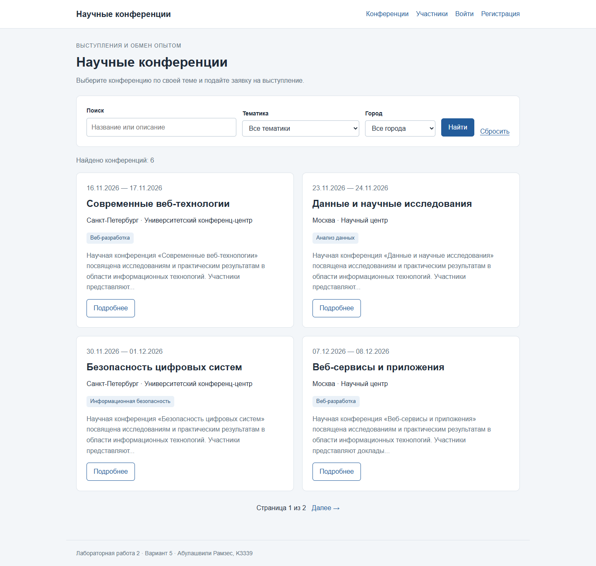](images/lab2/conferences-list.png)

### Представление списка конференций

Представление применяет условия поиска и фильтры, затем передаёт выбранную страницу в шаблон.

```python
def conference_list(request):
    conferences = Conference.objects.select_related("venue").prefetch_related("topics")
    query = request.GET.get("q", "").strip()
    topic = request.GET.get("topic", "")
    city = request.GET.get("city", "")
    if query:
        conferences = conferences.filter(Q(title__icontains=query) | Q(description__icontains=query))
    if topic.isdigit():
        conferences = conferences.filter(topics__pk=topic)
    if city:
        conferences = conferences.filter(venue__city=city)
    page = Paginator(conferences.distinct(), 4).get_page(request.GET.get("page"))
    filters = request.GET.copy()
    filters.pop("page", None)
    cities = Conference.objects.values_list("venue__city", flat=True).distinct().order_by("venue__city")
    return render(request, "conferences/list.html", {
        "page": page, "topics": Topic.objects.all(), "cities": cities,
        "query": query, "selected_topic": topic, "selected_city": city, "filters": filters.urlencode(),
    })
```

## Страница конференции

Подробная страница содержит полное описание конференции, список тематик,
даты проведения, адрес и описание площадки, условия участия.
Отсюда можно перейти к участникам, подать заявку и открыть форму отзыва.

[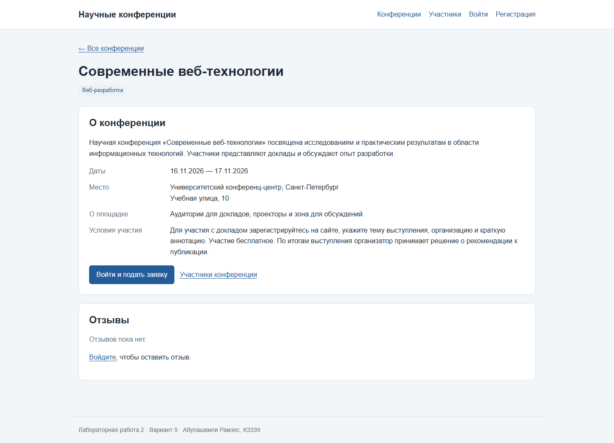](images/lab2/conference-detail.png)

## Подача, изменение и удаление заявки

В заявке автор указывает тему выступления, организацию и аннотацию.
Пользователь и конференция назначаются представлением.
Раздел «Мои заявки» показывает собственные регистрации пользователя.
В нём доступны редактирование и удаление с подтверждением.
После изменения содержания заявки её результат возвращается
в состояние «Ожидает решения».

[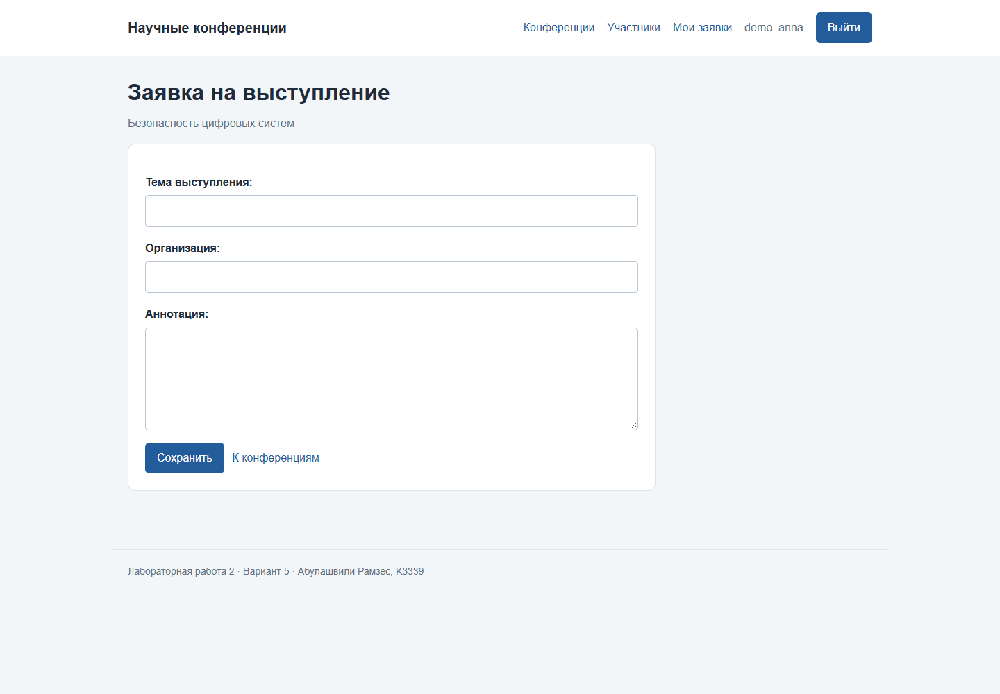](images/lab2/registration-form.png)

[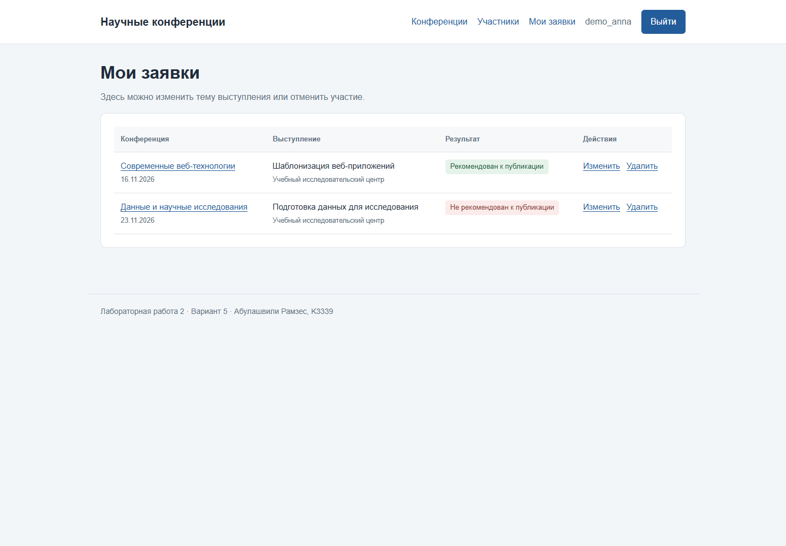](images/lab2/my-registrations.png)

### Представление подачи заявки

```python
@login_required
def registration_create(request, pk):
    conference = get_object_or_404(Conference, pk=pk)
    existing = conference.registrations.filter(author=request.user).first()
    if existing:
        return redirect("registration_edit", pk=existing.pk)
    form = RegistrationForm(request.POST or None)
    if request.method == "POST" and form.is_valid():
        registration = form.save(commit=False)
        registration.author = request.user
        registration.conference = conference
        registration.save()
        messages.success(request, "Заявка на выступление сохранена.")
        return redirect("my_registrations")
    return render(request, "form.html", {"form": form, "title": "Заявка на выступление", "subtitle": conference.title})
```

### Форма в шаблоне Jinja2

Шаблон получает форму из представления. `csrf_input` добавляет токен для POST-запроса,
а `form.as_p()` выводит поля и сообщения формы.

```html
<form method="post">
  {{ csrf_input }}
  {{ form.as_p() }}
  <button type="submit">Сохранить</button>
</form>
```

Меню организатора показывается пользователям с дополнительными правами:

```html

  <a href="{{ url('staff_registrations') }}">Организатор</a>

```

При получении заявки для редактирования представление выбирает её
по идентификатору и текущему пользователю:

```python
registration = get_object_or_404(Registration, pk=pk, author=request.user)
```

## Отзывы

Авторизованный пользователь может написать отзыв и поставить оценку от 1 до 10.
Вместе с отзывом сохраняются его автор, даты конференции и дата публикации.
Отзыв отображается на странице конференции. При повторном открытии формы
пользователь редактирует свой существующий отзыв.

[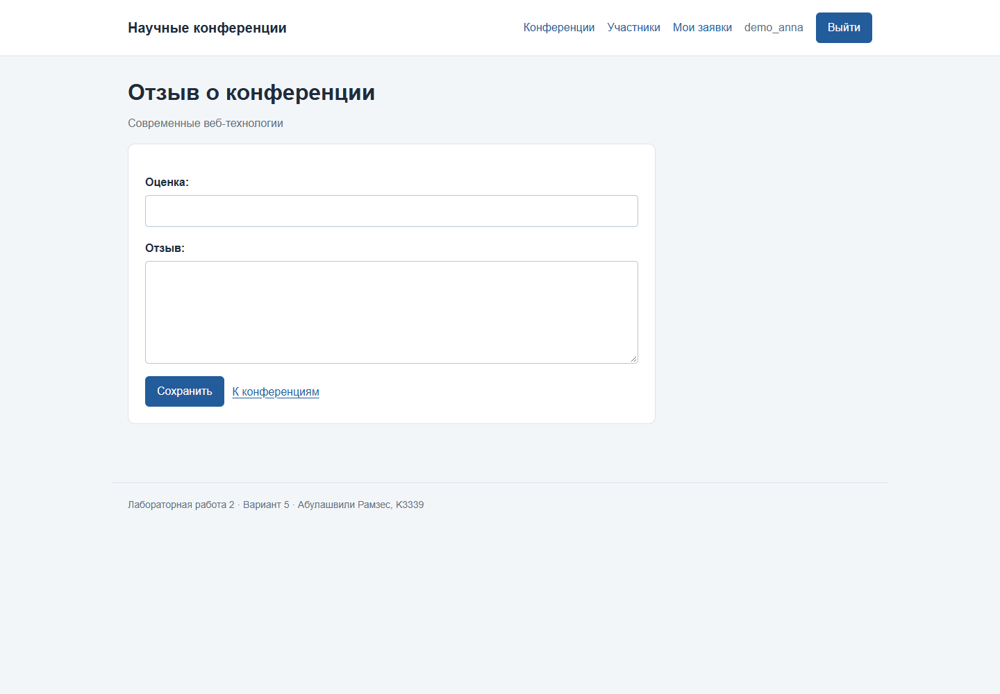](images/lab2/review-form.png)

## Действия организатора

Для сотрудников с `is_staff` или `is_superuser` в меню появляется
раздел «Организатор». Он содержит все заявки с фильтрами по конференции
и результату. На странице заявки организатор выбирает результат:

- ожидает решения;
- рекомендован к публикации;
- не рекомендован к публикации.

Проверка прав выполняется и в представлении. Обычный пользователь
управляет своими заявками, сотрудник дополнительно вносит результаты
выступлений через клиентский интерфейс.

[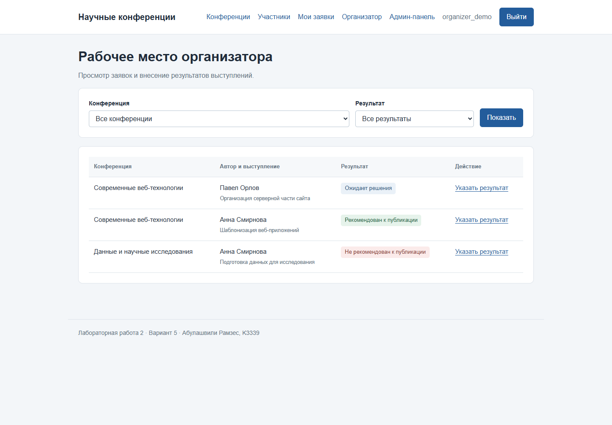](images/lab2/organizer.png)

[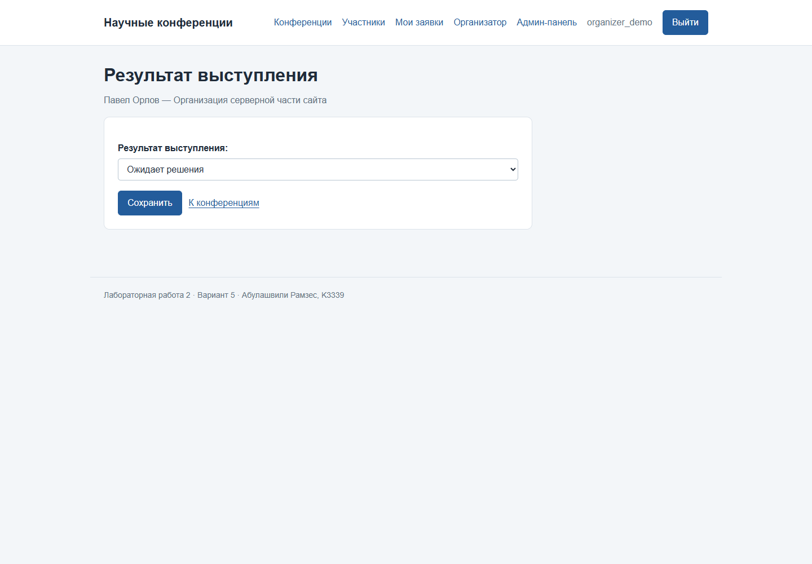](images/lab2/result-form.png)

Результаты также доступны в Django Admin. В панели зарегистрированы
конференции, тематики, площадки, заявки и отзывы.

[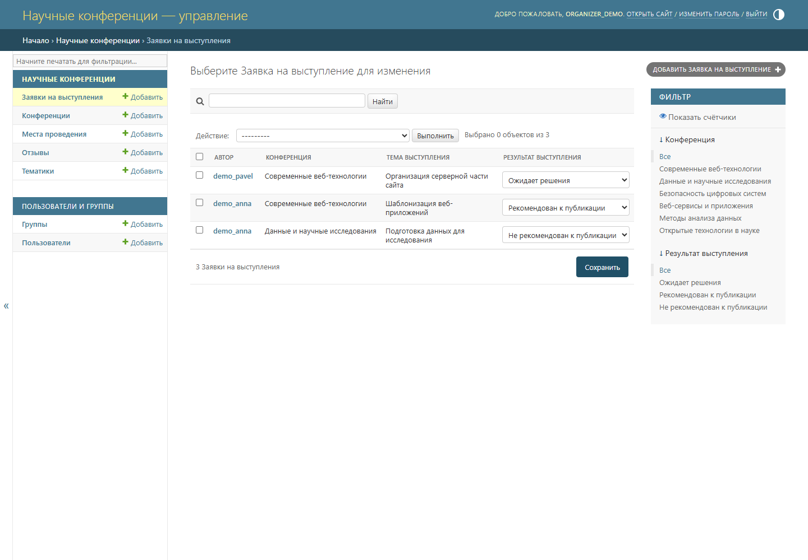](images/lab2/conferences-admin.png)

## Таблица участников

Страница «Участники» группирует записи по конференциям. В таблице указаны
имя и фамилия автора, организация, тема выступления и результат.
Можно выбрать одну конференцию или посмотреть участников всех конференций.

[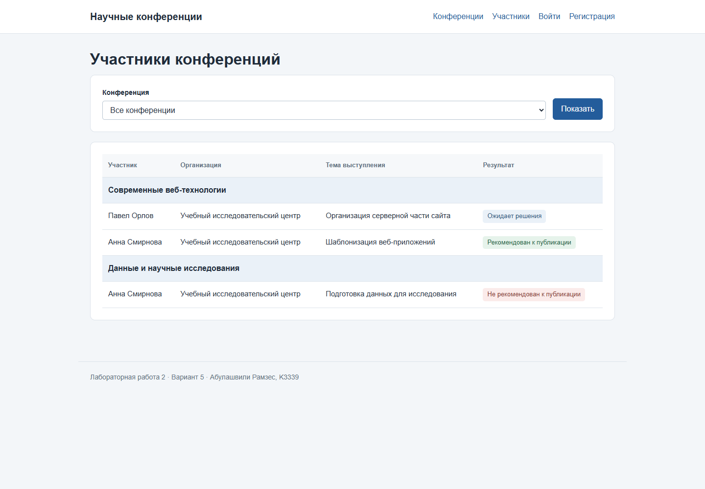](images/lab2/participants.png)

## Основные адреса

| Адрес | Назначение |
| --- | --- |
| `/` | Каталог, поиск, фильтры и страницы |
| `/signup/`, `/login/` | Регистрация и вход |
| `/conferences/<id>/` | Подробная страница конференции |
| `/conferences/<id>/register/` | Подача заявки |
| `/my-registrations/` | Собственные заявки пользователя |
| `/registrations/<id>/edit/` | Редактирование заявки |
| `/registrations/<id>/delete/` | Удаление заявки |
| `/conferences/<id>/review/` | Создание и изменение отзыва |
| `/participants/` | Участники по конференциям |
| `/organizer/` | Рабочее место организатора |
| `/organizer/<id>/result/` | Результат выступления |
| `/admin/` | Административная панель Django |

## Запуск

Зависимости устанавливаются в виртуальное окружение из `requirements.txt`.
Локальный скрипт `configure_database.py` создаёт базы PostgreSQL и настройки
подключения. Затем применяются миграции и добавляются учебные данные:

```powershell
python configure_database.py
python conference_project/manage.py migrate
python conference_project/manage.py seed_demo
python conference_project/manage.py createsuperuser
python conference_project/manage.py runserver 127.0.0.1:8000
```

Сайт открывается по адресу <http://127.0.0.1:8000/>.
Учебный набор содержит шесть конференций, три тематики, две площадки
и примеры заявок с разными результатами.

## Вывод

Разработан сайт научных конференций по варианту 5. Django обрабатывает запросы,
ORM сохраняет данные в PostgreSQL, Jinja2 формирует HTML-страницы.
Пользователь создаёт аккаунт, просматривает конференции, управляет своими
заявками и оставляет отзывы. Организатор вносит результаты выступлений
через сайт и административную панель. Реализованы таблица участников,
поиск, фильтрация, пагинация и оформление интерфейса.

## Источники

- [Задание ЛР2](https://rendex85.github.io/ITMO_ICT_WebDevelopment_Docs/lab2/assignment/).
- [Модели Django](https://docs.djangoproject.com/en/5.2/topics/db/models/).
- [Подключение Jinja2](https://docs.djangoproject.com/en/5.2/topics/templates/#django.template.backends.jinja2.Jinja2).
- [Формы на основе моделей](https://docs.djangoproject.com/en/5.2/topics/forms/modelforms/).
- [Пагинация Django](https://docs.djangoproject.com/en/5.2/topics/pagination/).
