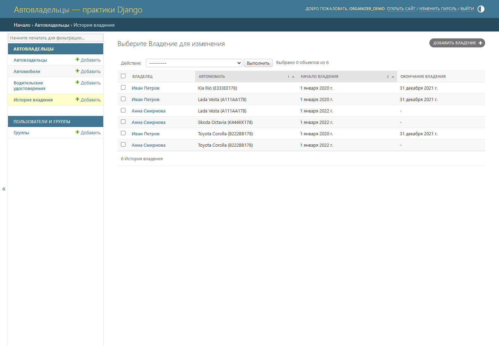
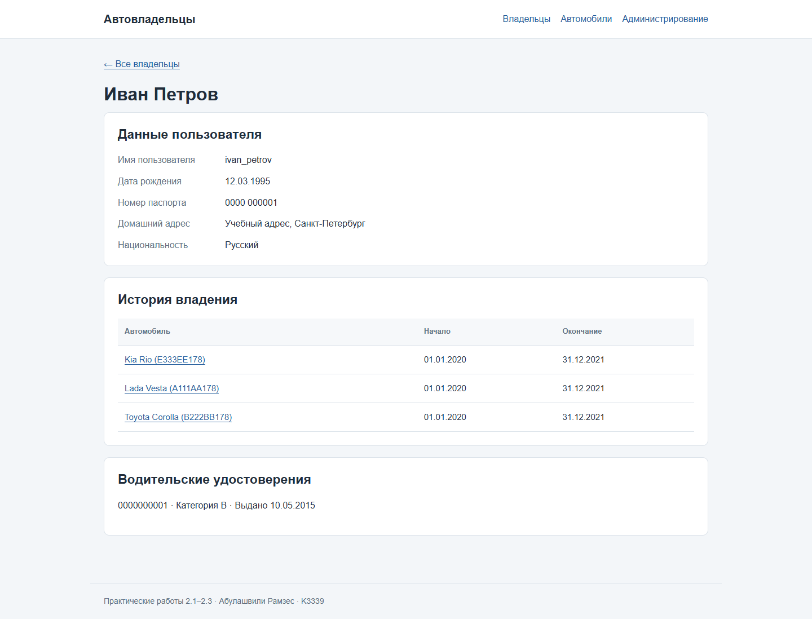

# Практическая работа 2.1. Первое приложение Django

**Студент:** Абулашвили Рамзес  
**Группа:** K3339

## Цель

Создать проект Django, описать модели автовладельцев, выполнить миграции
и вывести данные из базы на HTML-страницу.

## Структура проекта

Проект называется `django_project_abulashvili`, приложение — `project_first_app`.
Три практики объединены в одном проекте. В итоговой версии владелец автомобиля
является расширенным пользователем, как требуется в практике 2.3.

| Модель | Данные |
| --- | --- |
| `CarOwner` | Имя, фамилия, дата рождения и данные пользователя |
| `Car` | Государственный номер, марка, модель, цвет |
| `Ownership` | Владелец, автомобиль, начало и окончание владения |
| `DrivingLicense` | Владелец, номер удостоверения, категория, дата выдачи |

Владелец может иметь несколько автомобилей. Один автомобиль может последовательно
принадлежать разным владельцам. Для этой связи используется промежуточная модель
`Ownership`: в ней хранятся даты владения. Водительские удостоверения связаны
с владельцем внешним ключом.

### Модель владения

```python
class Ownership(models.Model):
    owner = models.ForeignKey(CarOwner, on_delete=models.CASCADE, verbose_name="Владелец")
    car = models.ForeignKey(Car, on_delete=models.CASCADE, verbose_name="Автомобиль")
    start_date = models.DateField("Начало владения")
    end_date = models.DateField("Окончание владения", null=True, blank=True)

    class Meta:
        ordering = ["car", "start_date"]
        verbose_name = "Владение"
        verbose_name_plural = "История владения"

    def clean(self):
        if self.start_date and self.end_date and self.end_date < self.start_date:
            raise ValidationError("Окончание владения не может быть раньше начала.")
        if self.car_id and self.start_date:
            periods = Ownership.objects.filter(car_id=self.car_id).exclude(pk=self.pk)
            periods = periods.filter(Q(end_date__isnull=True) | Q(end_date__gte=self.start_date))
            if self.end_date:
                periods = periods.filter(start_date__lte=self.end_date)
            if periods.exists():
                raise ValidationError("У автомобиля уже есть владелец в этот период.")

    def __str__(self):
        return f"{self.owner} — {self.car}"
```

## Миграции и административная панель

Модели зарегистрированы в `admin.py`. Администратор может добавлять владельцев,
автомобили, водительские удостоверения и записи об истории владения.
Для таблиц создана миграция `0001_initial.py`, база данных — PostgreSQL.

```powershell
python manage.py migrate
python manage.py createsuperuser
python manage.py runserver 127.0.0.1:8001
```

Эти команды выполняются из каталога проекта, в котором находится `manage.py`.

Административная панель находится по адресу <http://127.0.0.1:8001/admin/>.
В учебных данных есть четыре исходных автомобиля. Иван Петров и Анна Смирнова
связаны каждый с тремя автомобилями. У автомобилей, которые меняли владельца,
периоды владения не пересекаются: первый заканчивается 31.12.2021,
следующий начинается 01.01.2022.

[](images/lab2/practice-admin.png)

## Вывод владельца по идентификатору

Функция `owner_detail` получает идентификатор из URL, находит владельца
и передаёт его вместе с историей владения в шаблон `owner.html`.

```python
def owner_detail(request, owner_id):
    owner = get_object_or_404(CarOwner, pk=owner_id)
    periods = owner.ownership_set.select_related("car")
    return render(request, "owner.html", {"owner": owner, "periods": periods})
```

Маршрут `owner/<int:owner_id>/` объявлен в приложении. Главный `urls.py`
подключает маршруты приложения через `include()`.
Страница первого владельца: <http://127.0.0.1:8001/owner/1/>.

[](images/lab2/practice-owner.png)

## Результат

Созданы модели и таблицы базы данных. Данные доступны в административной панели
и на странице владельца. URL связывает запрос с представлением, представление
получает данные через ORM и передаёт их в шаблон.

## Источник

[Практическое занятие 2.1](https://rendex85.github.io/ITMO_ICT_WebDevelopment_Docs/lab2/practice1/).
