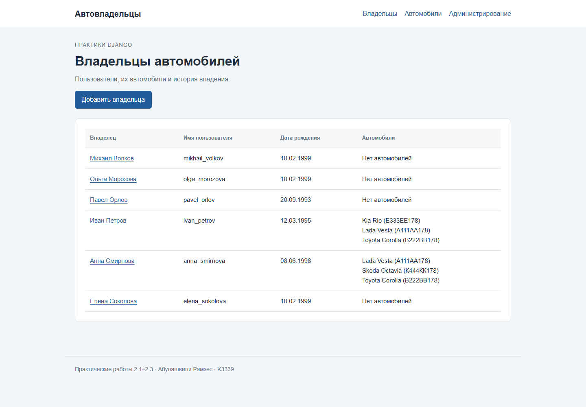
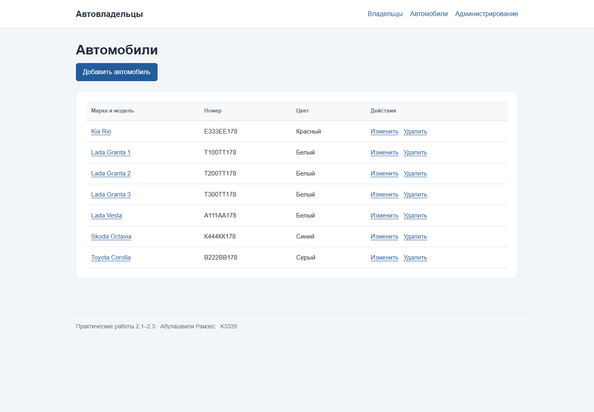

# Практическая работа 2.2. Представления и формы

**Студент:** Абулашвили Рамзес  
**Группа:** K3339

## Цель

Настроить связь многие-ко-многим, реализовать просмотр данных и операции
создания, изменения и удаления с помощью функциональных и классовых представлений.

## Связь моделей

Поле `Car.owners` описано как `ManyToManyField` с параметром `through="Ownership"`.
Дополнительная таблица хранит не только ссылки на автомобиль и владельца,
но и период владения. Связи создаются через объекты `Ownership`.

## Список владельцев: функциональное представление

Страница `/` показывает всех автовладельцев и их автомобили.
Каждое имя ведёт на страницу с подробной информацией.

```python
def owner_list(request):
    owners = CarOwner.objects.prefetch_related("cars")
    return render(request, "owners.html", {"owners": owners})
```

[](images/lab2/practice-owners.png)

## Автомобили: классовые представления

| Действие | Представление | Адрес |
| --- | --- | --- |
| Список | `CarListView`, наследник `ListView` | `/cars/` |
| Просмотр по id | `CarDetailView`, наследник `DetailView` | `/cars/<id>/` |
| Создание | `CarCreateView`, наследник `CreateView` | `/cars/new/` |
| Изменение | `CarUpdateView`, наследник `UpdateView` | `/cars/<id>/edit/` |
| Удаление | `CarDeleteView`, наследник `DeleteView` | `/cars/<id>/delete/` |

Форма автомобиля строится через `ModelForm`. В ней доступны государственный номер,
марка, модель и цвет. После сохранения открывается список автомобилей.
Перед удалением выводится отдельная страница подтверждения.

```python
class CarUpdateView(UpdateView):
    model = Car
    form_class = CarForm
    template_name = "form.html"
    success_url = reverse_lazy("cars")
    extra_context = {"title": "Редактирование автомобиля"}
```

[](images/lab2/practice-cars.png)

## Создание владельца через форму

Функциональное представление `owner_create` обрабатывает GET и POST.
GET открывает форму, POST сохраняет нового пользователя и переводит
на его страницу. К исходным трём владельцам через форму добавлены
Елена Соколова, Михаил Волков и Ольга Морозова. Через формы также добавлены
ещё три автомобиля; итоговый список содержит семь автомобилей.

```python
def owner_create(request):
    form = OwnerForm(request.POST or None)
    if request.method == "POST" and form.is_valid():
        owner = form.save()
        return redirect("owner_detail", owner_id=owner.pk)
    return render(request, "form.html", {"form": form, "title": "Новый автовладелец"})
```

## Результат

Функциональные представления используются для владельцев,
а классовые — для автомобилей. Реализованы просмотр списка и отдельной записи,
создание, изменение и удаление. Данные сохраняются в PostgreSQL.

## Источник

[Практическое занятие 2.2](https://rendex85.github.io/ITMO_ICT_WebDevelopment_Docs/lab2/practice2/).
