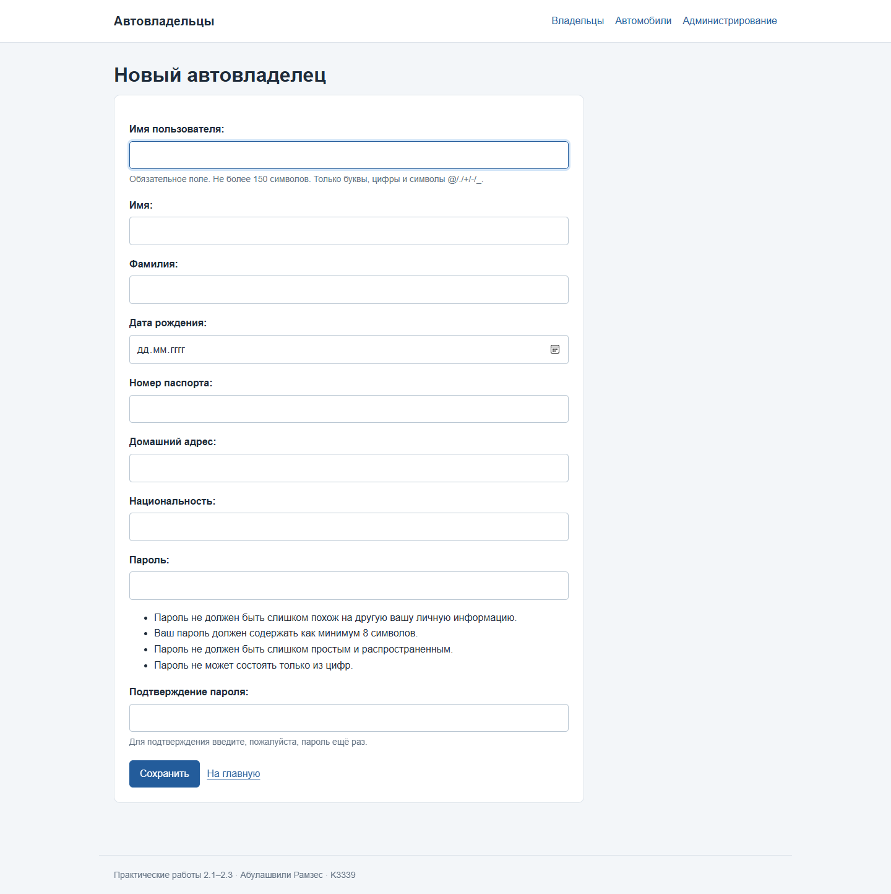

# Практическая работа 2.3. Расширение пользователя

**Студент:** Абулашвили Рамзес  
**Группа:** K3339

## Цель

Сделать автовладельца пользователем Django и добавить сведения,
которых нет у стандартной модели пользователя.

## Модель пользователя

`CarOwner` наследуется от `AbstractUser`. Поэтому у владельца есть имя пользователя,
пароль, имя, фамилия и права доступа. Дополнительно хранятся дата рождения,
номер паспорта, домашний адрес и национальность.

В настройках проекта указано:

```python
AUTH_USER_MODEL = "project_first_app.CarOwner"
```

Модель подключена до первой миграции, поэтому все отношения сразу ссылаются
на нужную таблицу пользователей.

```python
class CarOwner(AbstractUser):
    birth_date = models.DateField("Дата рождения", null=True, blank=True)
    passport_number = models.CharField("Номер паспорта", max_length=20)
    home_address = models.CharField("Домашний адрес", max_length=200)
    nationality = models.CharField("Национальность", max_length=50)

    class Meta:
        ordering = ["last_name", "first_name", "pk"]
        verbose_name = "Автовладелец"
        verbose_name_plural = "Автовладельцы"

    def __str__(self):
        return self.get_full_name() or self.username
```

## Создание пользователя

Форма `OwnerForm` наследуется от `UserCreationForm`. Она сохраняет пароль
стандартным механизмом Django и содержит новые поля автовладельца.
Представление формы остаётся функциональным, как требуется в практике 2.2.

```python
class OwnerForm(UserCreationForm):
    class Meta(UserCreationForm.Meta):
        model = CarOwner
        fields = ["username", "first_name", "last_name", "birth_date", "passport_number", "home_address", "nationality"]
        widgets = {"birth_date": DateInput(attrs={"type": "date"}, format="%Y-%m-%d")}
```

[](images/lab2/practice-form.png)

## Административная панель и вывод данных

Для владельцев используется `CarOwnerAdmin`, наследник `UserAdmin`.
Дополнительные поля включены и в создание, и в редактирование пользователя.
Список владельцев и страница владельца работают с новой моделью.
На странице показываются номер паспорта, адрес и национальность.
Для демонстрации используются вымышленные данные.

## Результат

Автовладелец стал пользователем Django. Новые атрибуты доступны
в форме создания, административной панели и клиентском интерфейсе.
Связи с автомобилями и водительскими удостоверениями сохранены.

## Источники

- [Практическое занятие 2.3](https://rendex85.github.io/ITMO_ICT_WebDevelopment_Docs/lab2/practice3/).
- [Изменение модели пользователя Django](https://docs.djangoproject.com/en/5.2/topics/auth/customizing/).
